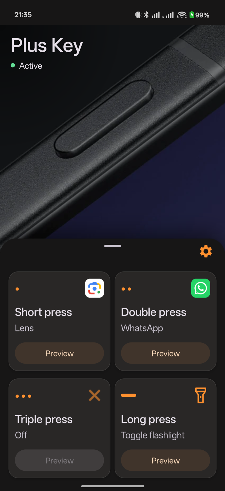
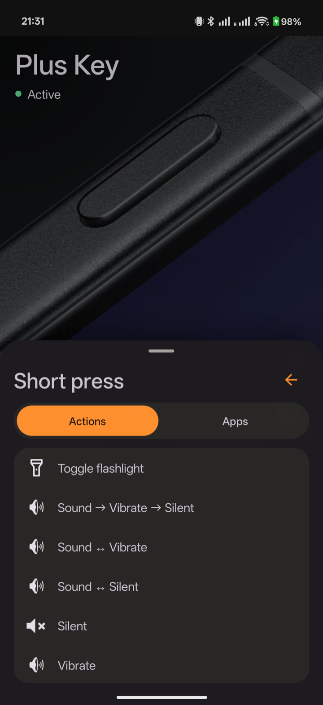
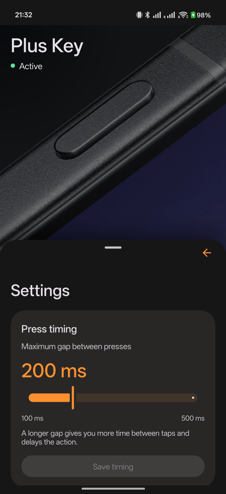

# PlusKey

Customize the OnePlus Plus Key with separate actions, apps, or app shortcuts for single, double, triple, and long presses. Built-in actions include flashlight, sound modes, screenshot, screen lock, notifications, quick settings, media, and volume.

  
  
  

## Install and setup

Plus Key works with Shizuku 13 or later or standalone using Wireless debugging. Install the APK from the latest release’s **Assets**, then open **Settings** in Plus Key.

- **With Shizuku** — Start Shizuku and tap **Allow Shizuku** in Plus Key. [Shizuku setup](https://shizuku.rikka.app/)
- **Standalone** — Follow the guided Wireless debugging setup and tap **Pair with code**. Keep Android’s pairing window open while entering the six-digit code in the Plus Key notification. After pairing, tap **Start** to reuse the saved connection.

Optional **Automatic startup** uses a protected-settings permission to turn on Wireless debugging while starting the helper and turn it off once ready. OxygenOS may require **Disable system optimisation** in Developer options, which can increase background power use. Android may ask for approval on a new Wi-Fi network. If the button disconnects after a reboot or system termination, open Plus Key and tap **Start**.

## Button behavior

- **Single, double, and triple press** — Double and triple press are off by default, so single press fires on release. When either is enabled, **Click interval** sets the time to start the next press. It defaults to 200 ms and can be adjusted from 100 to 500 ms.
- **Long press** — Toggle flashlight is the default on fresh installs with a flash. Custom long press fires once after 500 ms. Set the OnePlus assignment to **Do nothing** for custom long press, or choose **Managed by OnePlus** to keep the native action.
- **Assistant and app actions** — Choose **Start default assistant** under Actions. Under Apps, search for **Create note**, **Hands-free voice**, or **Configure shortcut**. Installed apps determine which options appear. Configured shortcuts run after unlocking.
- **While locked** — Flashlight, sound, media, volume, and lock actions can run while locked. Secure camera, lock-screen activities, note and hands-free handlers, and the default assistant can be requested while locked. Android and the receiving app control what opens and when authentication is required. On Android 16 or later, other apps, shortcuts, and actions can wake the screen and run if you unlock within 30 seconds and the firmware delivers the unlock callback. A new custom press replaces any pending action.

Successful custom actions give brief haptic feedback. Plus Key observes native button events, and OnePlus can still act on them. Accessible static app shortcuts are available in the picker.

## Compatibility

Tested on OnePlus 15 (CPH2747) running Android 17 and OxygenOS 17. Requires Android 11 or later to install. Other devices and firmware versions are unverified. Screen-off operation depends on whether the firmware delivers Plus Key events during standby.

## Updates and privacy

Plus Key checks GitHub for updates once daily when opened. Go to **Settings → App updates** to check manually or turn off automatic checks. Before handing an update to Android’s installer, Plus Key verifies the APK checksum, package name, version code, and signing certificate. Android requires your approval to install it.

No account or analytics. Pairing and helper connections stay on your phone. The pairing identity is stored privately and excluded from backup.

## Build and release

Requires JDK 21, Android SDK 37, and Build Tools 36.0.0. Supply the keystore password privately through `PLUS_LENS_KEYSTORE_PASSWORD`, then run `sh build.sh` to run host tests and build a signed APK. Use the same signing key to update an existing installation.

For public releases, increment Android’s `versionCode`, use a numeric tag such as `v1.5.1`, and attach one signed APK with a GitHub SHA-256 asset digest. Publish a regular GitHub release so the app can offer the update.

## License

[Apache License 2.0](LICENSE). Bundled dependency licenses are listed in [THIRD_PARTY.md](THIRD_PARTY.md). PlusKey is independent of OnePlus.
